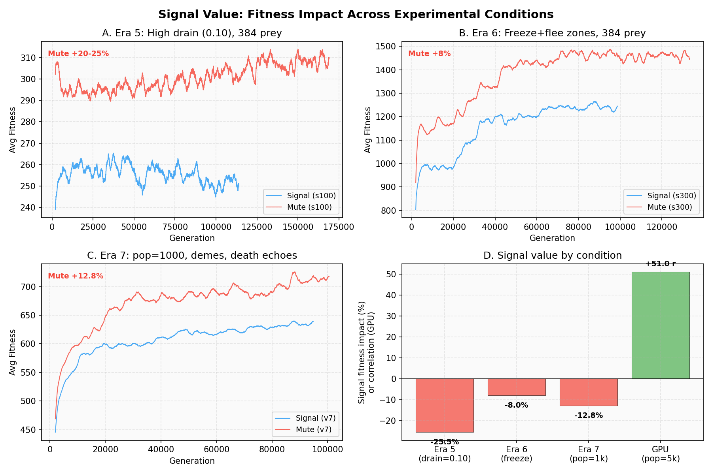

# semiotic-emergence

semiotic-emergence is an evolutionary simulation in Rust. It looks for the moment when signals
between agents first start to carry meaning.

Hundreds of small neural networks live on a toroidal grid under invisible lethal pressure. They
can send 6 symbols. At generation zero, the signals are noise.

## The main result

Signals help survival only with a large population and a complex environment.

- At 384 and 2,000 agents, signals are net negative. Mute prey are fitter in every configuration
  tested.
- At 5,000 agents (the GPU port), signals become adaptive (+0.51 correlation with survival).
- Invisible poison food at 2,000 agents gave the best signal quality in the project. One seed
  showed different roles for different symbols. A second seed did not reproduce this.



FINDINGS.md puts the threshold for adaptive signals between 2,000 and 5,000 agents. The
5,000-agent run used a different architecture, so architecture changes are probably also necessary.

| Claim | 384 agents | 2,000 agents | 5,000 agents (GPU) |
|---|---|---|---|
| Signals have adaptive value | No (-7% to -25%) | No (-7.3% seed 42, -5.3% seed 43) | Yes (r=+0.51) |
| Receivers change behavior | Weak yes | Yes | Yes |
| Different symbols carry different information | Yes, at drain 0.02 (food encoding) | Yes, in seed 42 | Weak |

The full evidence table, the disproven hypotheses and the open questions are in
[FINDINGS.md](FINDINGS.md). Figures, the world mechanics and the first summary are in
[Details](docs/details.md).

## How to run it

You need a Rust toolchain with Cargo.

```bash
cargo run --release -- 42 1000                    # seed 42, 1000 generations
cargo run --release -- 42 1000 --no-signals       # counterfactual: signals suppressed
cargo run --release -- 42 100000 --demes 3        # with group selection
cargo test                                        # run the tests
```

A run writes `output.csv`, `trajectory.csv` and `input_mi.csv`. To analyze a run, use
`python analyze.py output.csv --plot` (it needs NumPy). [Details](docs/details.md#output-and-analysis)
lists all analysis options.

## Documentation

| Document | Contents |
|---|---|
| [FRAMEWORK.md](FRAMEWORK.md) | The semiotic theory of the project: what meaning requires, the pre-semiotic zone, the measurement instruments |
| [FINDINGS.md](FINDINGS.md) | Standing conclusions, evidence hierarchy, disproven hypotheses, the metric problem |
| [EXPERIMENTS.md](EXPERIMENTS.md) | Chronological lab notebook: every era, run and parameter change, and why |
| [PERFORMANCE.md](PERFORMANCE.md) | Benchmarks and optimization notes |
| [docs/details.md](docs/details.md) | Figures, world mechanics, output files, source files |
| [gpu/](gpu/) | JAX/Python port for large runs (populations up to 100k on cloud GPUs) |

## Layout

```text
src/        Rust simulation: brain, evolution, world, signal, metrics, main loop
gpu/        JAX/Python port for GPU runs
data/       output of the important runs (see data/README.md)
figures/    figures and generate_figures.py
analyze.py  analysis of the CSV output
docs/       notes for readers
```

## License

The license is [MIT](LICENSE).
