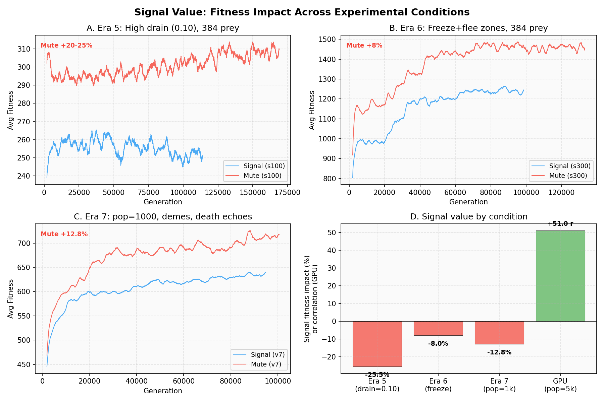
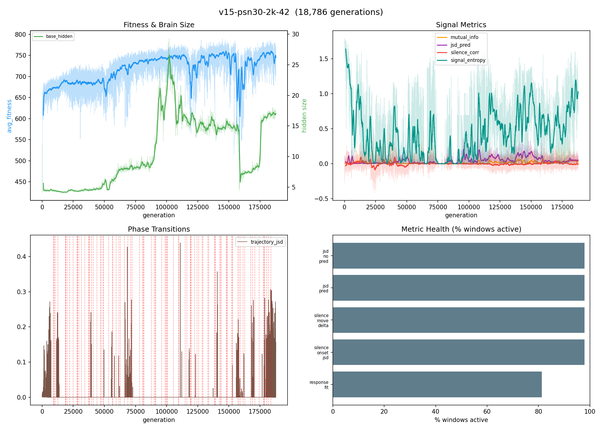
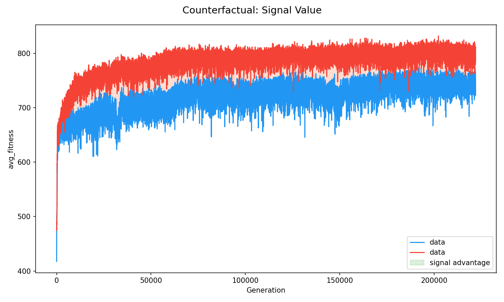

# Details

This file keeps the longer text from the earlier README. The short version is in the
[README](../README.md).

## The question

Every theory of signs starts from a world where meaning already exists. Peirce classifies signs
that are already signs. Saussure analyzes a language that is already a language. This simulation
looks at the gap before that: the moment when the world contains no meaning and then, for the
first time, it does.

Hundreds of neural networks live on a toroidal grid. They are under invisible lethal pressure and
have a 6-symbol broadcast channel. At generation zero, signals are noise. The question is: what
does it look like when meaning comes into existence for the first time?

## The answer so far

Signals become a survival resource through two factors together: population scale and
environmental complexity. At 384 agents, signals are net negative in every configuration tested (-7% to -25% fitness).
At 5,000 agents, signals become adaptive (+0.51 correlation with survival). The path there is not
only "add more agents". Environmental pressure is also necessary.


*Signal and mute fitness across experimental conditions. Signals hurt at small populations without
environmental complexity. The GPU run (pop=5000) shows positive signal value.*

One run added invisible poison food (visually identical, -0.3 energy) to a 2,000-agent
population. This run gave the strongest signal quality in the project: receivers that change behavior across symbols
survive better (response_fit_corr=+0.12, 95% positive). It also gave the first evidence of
functional vocabulary stratification. There is a dominant beacon, a poison-correlated signal and a
rare alarm, and each one causes a different change in behavior.

The population went through a 90,000-generation evolutionary winter. Brains collapsed from 24 to 7
neurons, then grew again to 17 with 10x better signal encoding. The disproven hypotheses in
[FINDINGS.md](../FINDINGS.md) and the experimental eras point to two variables:

- Population density gives the base of receivers.
- Environmental complexity gives the selection pressure for more than one distinct message.


*v15-2k+poison run. Top left: fitness (blue) and brain size (green). Brains grew to 24 neurons,
collapsed to 7, then grew again to 17 over about 90,000 generations. The regrown brain gave 10x
higher signal MI. Top right: signal metrics stay level after regrowth. Bottom left: phase
transitions (trajectory JSD spikes) follow the collapse and regrowth cycle.*


*Mute prey (red) keep a fitness advantage over signal prey (blue) across more than 200k
generations. Even with vocabulary stratification and positive response_fit_corr, signals stay net
negative at a population of 2k. The emergence threshold is above this scale.*

The second seed at 2k (seed 43) did not reproduce the positive response_fit_corr. See
[FINDINGS.md](../FINDINGS.md) for the evidence table.

## How the world works

- **Invisible kill zones** drift across the grid. Flee zones drain energy on a gradient. Freeze
  zones penalize movement. Prey feel pain but cannot see where the zones are.
- **Shared-layer neural networks** (39 inputs, an evolvable hidden layer of 4 to 64 neurons) give
  movement, memory updates and 6-symbol signal emissions through a sigmoid gate. The shared
  architecture makes spandrel correlations that can start communication.
- **Signals travel farther than vision.** Era 3 halved vision to 5.6 cells and kept signal range
  at 22.4 cells, a 4:1 ratio. Later eras changed vision again (see the parameter table in
  [EXPERIMENTS.md](../EXPERIMENTS.md)). With the 4:1 ratio, social information is the only source
  of spatial awareness beyond the nearby area of a prey.
- **Death witness inputs** make a 3-tier information chain. Prey near zone deaths get directional
  information that other prey do not have. Signals are the only way to pass it on.
- **Cooperative food patches** need 2 or more nearby prey to harvest. This rewards spatial
  coordination.
- **12 metric instruments** measure if signals carry meaning (mutual information), if they change
  receiver behavior (Jensen-Shannon divergence), and if they couple to fitness.

## Output and analysis

A run writes three files in the current directory:

- `output.csv`: one row per generation, 24 columns of fitness, signal and brain metrics.
- `trajectory.csv`: trajectory data for phase-transition analysis.
- `input_mi.csv`: mutual information between signals and each input.

`analyze.py` reads them. It needs Python and NumPy.

```bash
python analyze.py output.csv                              # single run
python analyze.py output.csv --plot                       # with charts
python analyze.py output.csv --json                       # structured output
python analyze.py run1.csv run2.csv                       # compare runs
python analyze.py output.csv --all t.csv i.csv            # with trajectory and input MI
python analyze.py output.csv --counterfactual nosig.csv   # signal value against a mute run
```

## The source files

```text
src/brain.rs      shared-layer NN (39 inputs, base hidden 4-64, sigmoid gate, 4 output heads)
src/evolution.rs  spatial evolution, deme-based group selection, lineage tracking
src/world.rs      grid, invisible kill zones, death echoes, poison food, energy economy
src/signal.rs     six symbols, configurable threshold, spatial signal grid
src/metrics.rs    12 instruments: MI, JSD, silence, trajectory, fitness coupling
src/main.rs       generation loop, CLI, checkpoint system
```

## The GPU port

The `gpu/` directory has a JAX/Python reimplementation for large GPU runs (Vast.ai, Colab). It
uses the same architecture and metrics as the Rust simulation. It aims at populations an order of
magnitude larger than the Rust CPU version can run. See [gpu/README.md](../gpu/README.md).
